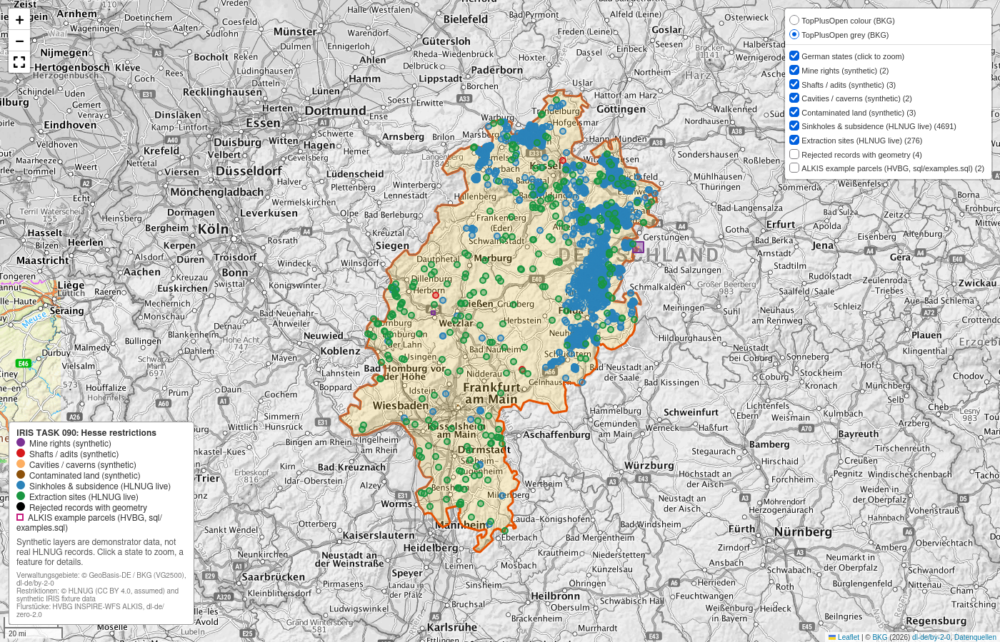
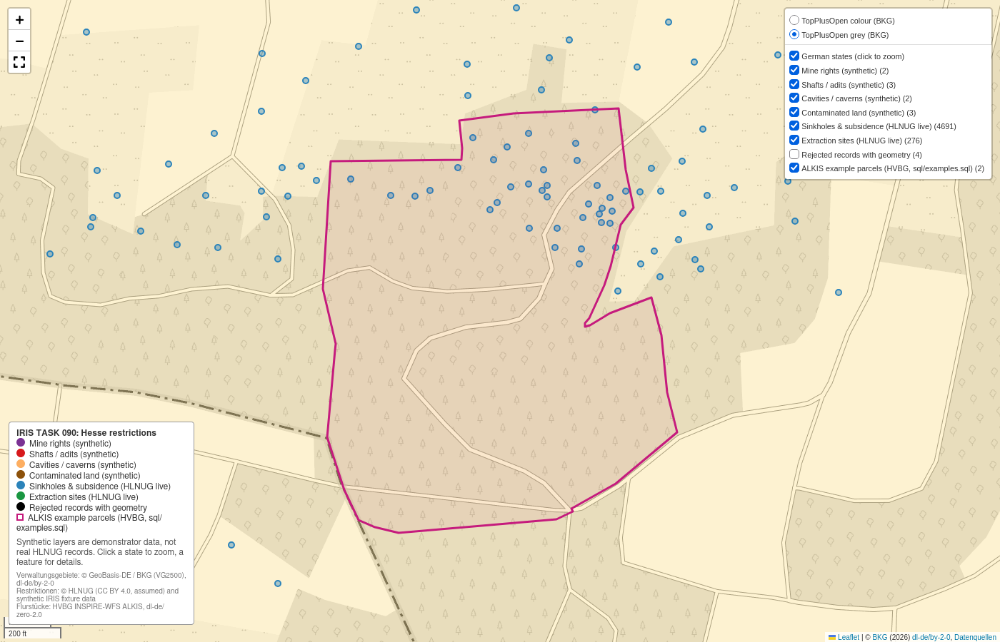

# IRIS-geohazard

IRIS TASK 090: a harvester for Hesse (Hessen) mine rights, shafts, cavities/caverns and contaminated land. It loads them into PostGIS staging (`iris_staging.mining_restrictions`) with per-row provenance, idempotent upserts and a visible table of rejected records.

## ▶ Guided demo

**New here? Run one command.** It needs only Docker with Compose and internet access.

```bash
./demo_of_codebase.sh
```

[](#map)

It walks through the whole project in 13 steps, pausing before each one. Every step names the task requirement it
covers, runs the real commands and queries, and shows a ✔/✘ check. It finishes by opening the interactive map. Add
`--fresh` to start from an empty database. Other options are under [Quick start](#quick-start).

> **Read this first: data availability.** There is **no public WFS** in Hesse for mine rights, shafts, cavities or
> contaminated land. The endpoint named in the task (`https://gds.hessen.de/wfs/altlasten`, layer `he_bergbau_kavernen`)
> does not exist. `gds.hessen.de` is the HLBG Geodatenshop, and the request returns HTTP 404. The four required categories
> are therefore delivered as a **fixture-based WFS demonstrator** with synthetic data. Two **real HLNUG layers** are
> harvested live alongside it, as a real-data check of the same pipeline. Details are in
> [docs/source_discovery.md](docs/source_discovery.md).

## Contents

- [Guided demo](#-guided-demo)
- [Provenance](#provenance)
- [Quick start](#quick-start)
- [Running](#running)
- [Configuration](#configuration)
- [Pipeline](#pipeline)
- [Schema](#schema)
- [Schema mapping](#schema-mapping)
- [Rules](#rules)
- [Example queries](#example-queries)
- [Map](#map)
- [Assumptions](#assumptions)
- [Limitations](#limitations)
- [Project layout](#project-layout)

## Provenance

| Source key | Mode | Endpoint | Layer | Category | License | Access |
|---|---|---|---|---|---|---|
| `hlnug_fixture_wfs` | fixture | `https://fixture.invalid/hlnug/wfs`, served from `fixtures/hlnug_demo/` | `hlnug_demo:he_bergbau_kavernen` | mine_right, shaft, cavity, contaminated_land | synthetic, none | none |
| `hlnug_geogefahren_erdfaelle` | live | `https://geodienste-umwelt.hessen.de/arcgis/rest/services/geologie/geogefahren/MapServer` | `20` Erdfälle und Senkungsmulden (Point, 4691 features) | sinkhole_subsidence | CC BY 4.0 (assumed, see below) | public, no restrictions |
| `hlnug_rohstoffe_abbaustellen` | live | `https://geodienste-umwelt.hessen.de/arcgis/rest/services/geologie/rohstoffe/MapServer` | `1` Abbaustellen (Point, 276 features) | extraction_site | CC BY 4.0 (assumed, see below) | public, no restrictions |

- **Attribution for live data:** © Hessisches Landesamt für Naturschutz, Umwelt und Geologie (HLNUG).
- **Live service details:**
  - ArcGIS Server 11.3, native EPSG:25832.
  - The WFS extension is not enabled, so features come through the ArcGIS REST `query` operation, paged, as GeoJSON.
- **License:**
  - HLNUG's published terms (`https://geodienste-umwelt.hessen.de/inspire/HLNUG_INSPIRE_Nutzungsbedingungen.txt`, Stand Mai 2025)
    state: no restrictions on public access, free private and commercial use, CC BY 4.0, not legally binding.
  - Those terms are written for HLNUG's INSPIRE services. Applying them to the `geologie/*` services is an **assumption**,
    and it is recorded as such in every row's `license`.
- **Not used:**
  - `haa/haa` (HTTP 403, restricted)
  - the Altflächendatei / FIS AG (not public)
  - Bergaufsicht (RP Darmstadt / Gießen / Kassel) mining data (no public service)
  - No access restriction was bypassed.
- **Per run:** source URL, layers, license, attribution, access constraints, fees, data currency and a capabilities hash are
  written to `iris_staging.harvest_runs` and logged at INFO.

## Quick start

Requirements: Docker with Compose and internet access (the live HLNUG layers, the state boundaries and the map tiles are
fetched online). Everything runs in containers (Python 3.15), so nothing needs to be installed on the host.

**Guided demo:** `./demo_of_codebase.sh` (see [above](#-guided-demo)) does all of the steps below in one go. Options:
- `--fresh` wipes the database volume first, so the first harvest shows every insert. It asks you to type "yes".
- `--yes` runs without pauses. Combined with `--fresh`, it also skips the confirmation and wipes without asking.
- `--no-open` builds the map without opening a browser.

It creates `.env` with a random password if there is none, and exits 1 if any check fails.

**1. Configure.** Copy the env template and set one password, used twice:

```bash
cp .env.example .env
# edit .env: set POSTGRES_PASSWORD and IRIS_DATABASE__PASSWORD to the same value
```

**2. Build and start the database.**

```bash
docker compose build
docker compose up -d --wait db
```

**3. Harvest.** This runs the migrations, then all three sources (synthetic fixture, Erdfälle, Abbaustellen):

```bash
docker compose run --rm harvester
```

Expected: the fixture source gives 16 fetched, 10 inserted and 6 rejected; Erdfälle 4691 inserted; Abbaustellen 276
inserted. Running it again gives 0 inserted and 0 updated for every source.

**4. Build the map.** The `-v` mount writes the HTML back to the host:

```bash
docker compose run --rm -v "$PWD":/app harvester "python -m visualize.make_map"
xdg-open visualize/output/hesse_restrictions_map.html
```

On a Mac, use `open` instead of `xdg-open`, or open the file in any browser. On the map, toggle the categories in the
layer control at the top right, click a feature for its details and source link, and click a state to zoom to it. See
[Map](#map) for the options.

**5. Optional checks.**

```bash
docker compose run --rm -v "$PWD":/app harvester "python -m pytest -v -p no:cacheprovider"
docker compose exec -T db sh -c 'psql -X -U "$POSTGRES_USER" -d "$POSTGRES_DB"' < sql/examples.sql
```

**Stop:** `docker compose down`. Add `-v` to also delete the database volume.

## Running

| Task | Command |
|---|---|
| Harvest all configured sources | `docker compose run --rm harvester` |
| One source only | `docker compose run --rm harvester "python -m geohazard.runner --source hlnug_fixture_wfs"` |
| Offline (fixture only) | same as above; the fixture source never touches the network |
| Tests (needs `db` running) | `docker compose run --rm -v "$PWD":/app harvester "python -m pytest -v -p no:cacheprovider"` |
| Example + validation SQL | `docker compose exec -T db sh -c 'psql -X -U "$POSTGRES_USER" -d "$POSTGRES_DB"' < sql/examples.sql` |
| Migrations only | `docker compose run --rm harvester "alembic upgrade head"` |
| Stop / wipe | `docker compose down` / `docker compose down -v` |
| Python lint and format check | `pre-commit run --all-files` (ruff check and ruff format, pinned in `.pre-commit-config.yaml`) |
| Shell script checks (CI only, optional locally) | `shellcheck demo_of_codebase.sh && shfmt -d demo_of_codebase.sh` (CI uses shellcheck 0.11.0 and shfmt 3.14.1; style from `.editorconfig`) |
| Enable the pre-commit hook (once per clone) | `pre-commit install`; commits are then blocked until ruff check and ruff format pass |

- **Exit codes:** the runner exits `0` when every source succeeds and `1` when any source fails. A failed source is recorded as
  `status = 'failed'` with its error in `harvest_runs`, and nothing from it is loaded.
- **Test database:** database tests run in a separate `<POSTGRES_DB>_test` database, created automatically, so they never
  touch harvested data. If PostGIS is unreachable, the database tests are skipped with a message.

<details>
<summary>Local run without Docker (optional)</summary>

```bash
uv python install 3.15
uv venv --python 3.15 && . .venv/bin/activate
pip install -r requirements-dev.txt -c requirements.lock
export IRIS_DATABASE__HOST=localhost IRIS_DATABASE__PASSWORD=... IRIS_CONFIG=config.example.yaml
alembic upgrade head && python -m geohazard.runner
```

</details>

## Configuration

- **Settings sources:** `geohazard/config/settings.py` reads environment variables (`IRIS_` prefix, `__` for nesting) on top of
  the YAML file named by `IRIS_CONFIG` (default `/app/config.example.yaml`).
- **Secrets:** they come only from the environment (`.env`, which is gitignored). `.env.example` and `config.example.yaml` contain
  no secrets.

| Setting | Env var | Default |
|---|---|---|
| Sources to run | `IRIS_SOURCES` (JSON list) | `config.example.yaml` lists all three |
| DB host/port/name/user/password | `IRIS_DATABASE__HOST` … `IRIS_DATABASE__PASSWORD` | `localhost` / `5432` / `iris` / `iris` / empty |
| HTTP timeout, retries, backoff, page size | `IRIS_HTTP__TIMEOUT_SECONDS` … `IRIS_HTTP__PAGE_SIZE` | 60 s, 3, 1.5, 1000 |
| Log level | `IRIS_LOG_LEVEL` | `INFO` |

Source definitions live in `geohazard/config/data_sources.py`: URL, layers, id/category/status/classification fields,
category and status maps, classification vocabulary, license and access text.

## Pipeline

The structure follows the iris-sample repo's layout (scraper, parser, transformer, loader, runner).

```
scraper  ──►  parser  ──►  transformer  ──►  loader
WFS 2.0 /     GeoJSON /    map, validate,    upsert + rejects
ArcGIS REST   GML → GDF    reproject, hash   + run log
```

1. **Scraper** (`geohazard/scrapers/`):
   - `WfsScraper`:
     - parses GetCapabilities with OWSLib and fails if the layer is not offered
     - reads DescribeFeatureType and fails if the id field is missing
     - pages through GetFeature with `count`/`startIndex`, using JSON when offered and GML 3.2 otherwise
   - `ArcgisRestScraper` pages through `query` with `outSR=25832` and `exceededTransferLimit`.
   - Both retry on 429 and 5xx errors. `FixtureAdapter` serves `fixtures/hlnug_demo/` to `requests`, so fixture mode runs
     exactly the live code path.
2. **Parser** (`geohazard/parsers/feature_parser.py`):
   - Produces a GeoDataFrame per layer, with the CRS taken from the response (the GeoJSON `crs` member, or GML `srsName` via
     pyogrio).
   - If pages of one layer declare different CRSs, the layer fails.
3. **Transformer** (`geohazard/transformers/hazard_transformer.py`): applies the [rules](#rules).
4. **Loader** (`geohazard/loaders/postgis_loader.py`):
   - The run row is written in its own transaction.
   - All staged and rejected rows of a run go in one transaction, so a failure leaves nothing partial.

## Schema

Migration: `migrations/versions/0001_create_iris_staging.py`. Every object, including `alembic_version`, lives in `iris_staging`.

### `iris_staging.mining_restrictions`

| Column | Notes |
|---|---|
| `source`, `source_feature_id` | **Stable key**, `UNIQUE (source, source_feature_id)` |
| `restriction_category` | CHECK: `mine_right`, `shaft`, `cavity`, `contaminated_land`, `sinkhole_subsidence`, `extraction_site` |
| `hazard_type` | raw source type value (e.g. `Kaverne`, `ABBAUART`) |
| `status`, `status_raw` | normalised status (NULL if unmapped) and the verbatim source value |
| `hazard_classification` | the published value verbatim; **NULL when not published** |
| `classification_status` | `published` / `missing` / `unrecognised`; CHECK ties `missing` to a NULL classification |
| `attributes` | all raw source properties (jsonb) |
| `geom` | `geometry(Geometry, 25832)`, **GIST index**, CHECK `ST_IsValid AND NOT ST_IsEmpty` |
| `geom_type`, `geom_was_repaired`, `source_crs` | geometry provenance |
| `content_hash` | SHA-256 of the mapped fields, attributes, license, per-feature URL and normalised WKB |
| `source_url` | **per-feature URL** (WFS `GetFeature&resourceId=<id>`, or ArcGIS `query?where=<id_field>=<id>`) |
| `layer_name`, `license`, `fetched_at` | per-row provenance |
| `first_seen_at`, `last_changed_at`, `last_run_id` | change tracking; `last_run_id` → `harvest_runs` |

### `iris_staging.mining_restrictions_rejected`

- **Columns:** `run_id`, `source`, `layer_name`, `source_feature_id` (nullable), `reason_code` (CHECK list),
  `reason_detail`, `raw_feature` (jsonb), `raw_geometry_wkt`, `source_url`, `fetched_at`, `rejected_at`.
- **One row per rejected feature per run.**

### `iris_staging.harvest_runs`

- **Columns:** `run_id`, `source_key`, `source`, `mode` (`live`/`fixture`), `status` (`running`/`succeeded`/`failed`),
  `started_at`, `finished_at`, `source_url`, `layer_names`, `license`, `attribution`, `access_constraints`, `fees`,
  `data_currency`, `capabilities_hash`, the counts (`fetched`, `inserted`, `updated`, `unchanged`, `rejected`), `error`.

## Schema mapping

| Target column | Fixture WFS `he_bergbau_kavernen` | Live `geogefahren/20` | Live `rohstoffe/1` |
|---|---|---|---|
| `source` | `hlnug_demo` | `hlnug:geologie/geogefahren/20` | `hlnug:geologie/rohstoffe/1` |
| `source_feature_id` | `OBJEKT_ID` | `OBJECTID` | `OBJECTID` |
| `restriction_category` | `OBJEKTART` via category map | fixed `sinkhole_subsidence` | fixed `extraction_site` |
| `hazard_type` | `OBJEKTART` | – | `ABBAUART` |
| `status_raw` → `status` | `STATUS` via status map | – | `GEWINNUNGS` (raw only) |
| `hazard_classification` | `GEFAEHRDUNGSKLASSE` | – (always `missing`) | – (always `missing`) |
| `attributes` | all properties | `OBJECTID`, `AMT_NR`, `TS_FLAE` | all 13 fields incl. `ABBAURECHT`, `ROHSTOFF`, `FIRMA` |

**Fixture category map** (`OBJEKTART`, matched case- and umlaut-insensitively):

| Source value | Category |
|---|---|
| Bergbauberechtigung, Bergwerkseigentum, Bewilligung | `mine_right` |
| Schacht, Stollen, Tagesöffnung | `shaft` |
| Hohlraum, Kaverne, Grubenbau | `cavity` |
| Altfläche, Altablagerung, Altstandort, Altlast | `contaminated_land` |

Anything else is rejected as `unmapped_category`.

**Fixture status map:**

| Source value | Status |
|---|---|
| aktiv, in Betrieb | `active` |
| stillgelegt | `abandoned` |
| erloschen | `expired` |
| verfüllt | `backfilled` |
| saniert | `remediated` |
| in Bearbeitung | `under_investigation` |
| altlastverdächtig | `suspected` |

**Fixture classification vocabulary:** `hoch`, `mittel`, `gering`, `Keine Gefährdung bekannt`.

## Rules

**Classification:** a missing value is never treated as safe.

| Source value | `hazard_classification` | `classification_status` |
|---|---|---|
| a vocabulary value, e.g. `gering` | `gering` (verbatim) | `published` |
| any other non-empty value, e.g. `Klasse 7` | verbatim | `unrecognised` |
| null, absent field, `""`, `unbekannt`, `k.A.`, `n.b.`, `-` | **NULL** | `missing` |
| source has no classification field (both live layers) | **NULL** | `missing` |

- No code path writes a default class.
- The database CHECK makes `missing` with a value impossible.
- "Keine Gefährdung bekannt" is stored only when the source publishes it.

**Checks, in order.** Each failure lands in `mining_restrictions_rejected` with its `reason_code` and is logged at WARNING
with the feature ID.

| # | Check | Reject reason |
|---|---|---|
| 1 | id field present | `missing_feature_id` |
| 2 | id not already seen in this fetch (first occurrence kept) | `duplicate_feature_id` |
| 3 | response declares a CRS in {25832, 31467, 4326, 4258} | `unknown_crs` (a CRS is never assumed) |
| 4 | category maps | `unmapped_category` |
| 5 | geometry not null | `null_geometry` |
| 6 | geometry not empty | `empty_geometry` |
| 7 | geometry type allowed for the layer | `unsupported_geometry_type` |
| 8 | valid, or repairable with `make_valid(method="structure")` (flagged `geom_was_repaired`) | `invalid_geometry_unrepairable` |
| 9 | after reprojection to EPSG:25832, inside the Hesse bbox (400000 5460000, 600000 5740000) | `out_of_region` (catches a wrong CRS or swapped axes) |
| 10 | still valid and non-empty at 1 mm precision | `invalid_geometry_unrepairable` |

**Idempotency:**

```sql
INSERT ... ON CONFLICT (source, source_feature_id) DO UPDATE SET ...
WHERE mining_restrictions.content_hash IS DISTINCT FROM EXCLUDED.content_hash
RETURNING (xmax = 0) AS inserted
```

- The hash excludes `fetched_at` and `run_id`, so unchanged features are left untouched, including their `last_run_id` and
  `last_changed_at`.
- A re-run produces 0 inserted and 0 updated. A changed feature is updated exactly once.

## Example queries

[`sql/examples.sql`](sql/examples.sql) contains the parcel-overlap and proximity examples and nine validation checks. The
captured output is in [`docs/validation_output.txt`](docs/validation_output.txt).

The parcel examples use **real Hesse cadastral parcels**. They come from the HVBG
[INSPIRE-WFS HE Flurstücke/Grundstücke ALKIS](https://inspire-hessen.de/ows/services/org.2.07247d95-adc7-4c7d-9c7a-ed17af855317_wfs?SERVICE=WFS&REQUEST=GetCapabilities&VERSION=2.0.0)
(`cp:CadastralParcel`, dl-de/zero-2.0, no access restrictions), fetched on 2026-10-28. They are embedded in the script
as psql variables (`:'parcel_297'`, `:'parcel_10_5'`), so the examples write nothing to the database.
- **Flurstück 297** (`06216400600297`, about 9.85°E 51.07°N in northeast Hesse, 35 mapped sinkholes inside it) was requested as GML in EPSG:25832.
- **Flurstück 10/5** (`061610001000100005`, at the Würmersen sandstone quarry) was requested as GeoJSON. That comes back
  in lon/lat (RFC 7946) whatever `srsName` asks for, so it is read as EPSG:4258 and transformed.

```sql
-- parcel overlap (parcel in any CRS -> transform to 25832 so the GIST index is used)
SELECT r.source_feature_id, r.restriction_category, r.classification_status, r.source_url
FROM iris_staging.mining_restrictions r
WHERE ST_Intersects(r.geom, ST_Transform(ST_GeomFromText(:'parcel_10_5', 4258), 25832));

-- proximity in metres (EPSG:25832 is metric)
SELECT r.restriction_category, count(*) AS n
FROM iris_staging.mining_restrictions r,
     (SELECT ST_GeomFromText(:'parcel_297', 25832) AS geom) p
WHERE ST_DWithin(r.geom, p.geom, 250) AND NOT ST_Intersects(r.geom, p.geom)
GROUP BY 1;
```

Excerpt of the output:

```
== 2. Parcel overlap: real ALKIS parcel delivered in EPSG:4258 lon/lat, transformed to 25832 before the GIST-indexed test (Flurstück 10/5)
           source           | source_feature_id | restriction_category |         site_name          | extraction_type | classification_status | parcel_m2
----------------------------+-------------------+----------------------+----------------------------+-----------------+-----------------------+-----------
 hlnug:geologie/rohstoffe/1 | 1                 | extraction_site      | Sandsteintagebau Würmersen | Trockenabbau    | missing               |     20352

== 3. Proximity: restrictions within 250 m of the Flurstück 297 boundary but outside it (EPSG:25832 units are metres)
 restriction_category | n  | nearest_m | farthest_m
----------------------+----+-----------+------------
 sinkhole_subsidence  | 65 |       0.6 |      248.0

== V2. Geometry integrity (expect all zeros)
 invalid | empty | wrong_srid | outside_hesse_bbox | repaired_kept
---------+-------+------------+--------------------+---------------
       0 |     0 |          0 |                  0 |             1
```

## Map

`visualize/make_map.py` renders everything in `iris_staging` onto an interactive map of Germany's 16 states. Hesse is
highlighted and zoomed by default.




```bash
docker compose up -d --wait db
docker compose run --rm -v "$PWD":/app harvester "python -m visualize.make_map"
xdg-open visualize/output/hesse_restrictions_map.html     # or open the file in any browser
```

- **States:** clicking a state zooms to it. `--state Bayern` (any VG2500 state name) changes the highlighted state.
- **Features:** every feature has a popup with category, ID, source, type, status, classification, CRS, license and a link to
  its per-feature source URL. A missing classification is shown as **MISSING (not published, not safe)**.
- **Layers:** each category is its own toggle, with counts, and synthetic layers are labelled as synthetic. A hidden-by-default
  layer shows the rejected records of the latest run that still have a geometry (e.g. the out-of-region and unrepairable ones).
- **Example parcels:** a second hidden-by-default layer, "ALKIS example parcels", draws the two real HVBG parcels used in
  `sql/examples.sql` (Flurstück 297 and 10/5) as magenta outlines, with Flurstück number, cadastral reference, official
  area and license in the popup. They come from `visualize/example_parcels.geojson` (committed, generated from the SQL
  variables so both use identical geometry); `--parcels <file>` draws a different GeoJSON instead. They are drawn only
  on the map and are not written to the database.
- **Sources:**
  - state boundaries: BKG VG2500 WFS (`vg2500:vg2500_lan`, land areas only), cached in `visualize/data/`; `--refresh-states`
    re-downloads them
  - basemap: BKG TopPlusOpen tiles
  - both are © GeoBasis-DE / BKG, dl-de/by-2-0, with no key and no access restrictions
- **Output:** a self-contained HTML file of about 5 MB. Leaflet and folium assets load from a CDN, so viewing it needs internet
  access. `visualize/output/` and `visualize/data/` are gitignored.
- **Dependency:** folium (pinned in `requirements-dev.txt` and `requirements.lock`).
- **Zoomed views:** `--show-parcels` opens with the parcel layer on, and `--zoom-to-parcel 297` opens zoomed to that parcel
  (used for the second screenshot above).

### Live maps on GitHub

GitHub draws GeoJSON as an interactive map with no hosting needed. The maps below can be panned, zoomed and clicked
right here in the README; clicking a feature shows its properties, including the per-feature source URL.

- **Everything:** [docs/map/hesse_restrictions.geojson](docs/map/hesse_restrictions.geojson) has all accepted features
  (about 5000). Open it on GitHub for a full-screen interactive map.
- **Snapshot:** these files are a snapshot of the database when they were generated, not live data.
- **Refresh:** regenerate all three GeoJSON files and the two README blocks below with:

  ```bash
  docker compose run --rm -v "$PWD":/app harvester "python -m visualize.make_map --github-maps"
  ```

- **Colours:** the same as the folium map. GitHub uses its own basemap, and it has no layer toggles or legend.
- **Attribution:** restrictions © HLNUG (CC BY 4.0, assumed) and synthetic IRIS fixture data. Flurstücke from the HVBG
  INSPIRE-WFS ALKIS, dl-de/zero-2.0. GitHub adds its own basemap attribution.

**Flurstück 297 and every restriction within 250 m** (example 1 and 3 of `sql/examples.sql`):

<!-- github-map:parcel_297_example -->
```geojson
{"type":"FeatureCollection","name":"parcel_297_example","attribution":"Restrictions: © HLNUG (CC BY 4.0, assumed) and synthetic IRIS fixture data; Flurstücke: HVBG INSPIRE-WFS ALKIS, dl-de/zero-2.0","features":[{"type":"Feature","properties":{"title":"Flurstück 297 (ALKIS example parcel)","flurstueck":"297","national_cadastral_reference":"06216400600297","official_area_m2":131057,"license":"dl-de/zero-2.0","source_service":"https://inspire-hessen.de/ows/services/org.2.07247d95-adc7-4c7d-9c7a-ed17af855317_wfs","stroke":"#c51b7d","stroke-width":3,"fill":"#c51b7d","fill-opacity":0.05},"geometry":{"type":"Polygon","coordinates":[[[9.847836,51.068672],[9.848074,51.068221],[9.848099,51.068177],[9.848133,51.068131],[9.848315,51.067889],[9.848555,51.067823],[9.848909,51.067766],[9.850058,51.067836],[9.850971,51.067878],[9.851277,51.0679],[9.851525,51.067969],[9.851506,51.067996],[9.852169,51.068231],[9.853074,51.068713],[9.853093,51.068718],[9.852943,51.069097],[9.852862,51.069637],[9.852712,51.069992],[9.852087,51.069844],[9.851781,51.069731],[9.85171,51.069721],[9.85171,51.069753],[9.851779,51.069802],[9.851999,51.070112],[9.8521,51.070288],[9.852249,51.070684],[9.852436,51.070845],[9.852397,51.070942],[9.852323,51.071202],[9.852269,51.071469],[9.852256,51.071522],[9.852216,51.071781],[9.851064,51.07175],[9.850635,51.071734],[9.850495,51.071718],[9.849825,51.071664],[9.849867,51.0714],[9.849854,51.071296],[9.847894,51.07128],[9.847881,51.071159],[9.847854,51.070891],[9.84777,51.070073],[9.847969,51.069554],[9.847961,51.069498],[9.847836,51.068672]]]}},{"type":"Feature","properties":{"title":"Sinkholes & subsidence (HLNUG live): 1001","category":"sinkhole_subsidence","feature_id":"1001","source":"hlnug:geologie/geogefahren/20","type":null,"status":null,"classification":"MISSING (not published, not safe)","source_url":"https://geodienste-umwelt.hessen.de/arcgis/rest/services/geologie/geogefahren/MapServer/20/query?where=OBJECTID%3D1001&outFields=%2A&f=geojson","marker-color":"#2b83ba","marker-size":"small"},"geometry":{"type":"Point","coordinates":[9.850021,51.071503]}},{"type":"Feature","properties":{"title":"Sinkholes & subsidence (HLNUG live): 1003","category":"sinkhole_subsidence","feature_id":"1003","source":"hlnug:geologie/geogefahren/20","type":null,"status":null,"classification":"MISSING (not published, not safe)","source_url":"https://geodienste-umwelt.hessen.de/arcgis/rest/services/geologie/geogefahren/MapServer/20/query?where=OBJECTID%3D1003&outFields=%2A&f=geojson","marker-color":"#2b83ba","marker-size":"small"},"geometry":{"type":"Point","coordinates":[9.846145,51.071547]}},{"type":"Feature","properties":{"title":"Sinkholes & subsidence (HLNUG live): 1004","category":"sinkhole_subsidence","feature_id":"1004","source":"hlnug:geologie/geogefahren/20","type":null,"status":null,"classification":"MISSING (not published, not safe)","source_url":"https://geodienste-umwelt.hessen.de/arcgis/rest/services/geologie/geogefahren/MapServer/20/query?where=OBJECTID%3D1004&outFields=%2A&f=geojson","marker-color":"#2b83ba","marker-size":"small"},"geometry":{"type":"Point","coordinates":[9.855847,51.07142]}},{"type":"Feature","properties":{"title":"Sinkholes & subsidence (HLNUG live): 1007","category":"sinkhole_subsidence","feature_id":"1007","source":"hlnug:geologie/geogefahren/20","type":null,"status":null,"classification":"MISSING (not published, not safe)","source_url":"https://geodienste-umwelt.hessen.de/arcgis/rest/services/geologie/geogefahren/MapServer/20/query?where=OBJECTID%3D1007&outFields=%2A&f=geojson","marker-color":"#2b83ba","marker-size":"small"},"geometry":{"type":"Point","coordinates":[9.850538,51.071418]}},{"type":"Feature","properties":{"title":"Sinkholes & subsidence (HLNUG live): 1011","category":"sinkhole_subsidence","feature_id":"1011","source":"hlnug:geologie/geogefahren/20","type":null,"status":null,"classification":"MISSING (not published, not safe)","source_url":"https://geodienste-umwelt.hessen.de/arcgis/rest/services/geologie/geogefahren/MapServer/20/query?where=OBJECTID%3D1011&outFields=%2A&f=geojson","marker-color":"#2b83ba","marker-size":"small"},"geometry":{"type":"Point","coordinates":[9.853169,51.071282]}},{"type":"Feature","properties":{"title":"Sinkholes & subsidence (HLNUG live): 1014","category":"sinkhole_subsidence","feature_id":"1014","source":"hlnug:geologie/geogefahren/20","type":null,"status":null,"classification":"MISSING (not published, not safe)","source_url":"https://geodienste-umwelt.hessen.de/arcgis/rest/services/geologie/geogefahren/MapServer/20/query?where=OBJECTID%3D1014&outFields=%2A&f=geojson","marker-color":"#2b83ba","marker-size":"small"},"geometry":{"type":"Point","coordinates":[9.851588,51.071289]}},{"type":"Feature","properties":{"title":"Sinkholes & subsidence (HLNUG live): 1015","category":"sinkhole_subsidence","feature_id":"1015","source":"hlnug:geologie/geogefahren/20","type":null,"status":null,"classification":"MISSING (not published, not safe)","source_url":"https://geodienste-umwelt.hessen.de/arcgis/rest/services/geologie/geogefahren/MapServer/20/query?where=OBJECTID%3D1015&outFields=%2A&f=geojson","marker-color":"#2b83ba","marker-size":"small"},"geometry":{"type":"Point","coordinates":[9.851087,51.071201]}},{"type":"Feature","properties":{"title":"Sinkholes & subsidence (HLNUG live): 1016","category":"sinkhole_subsidence","feature_id":"1016","source":"hlnug:geologie/geogefahren/20","type":null,"status":null,"classification":"MISSING (not published, not safe)","source_url":"https://geodienste-umwelt.hessen.de/arcgis/rest/services/geologie/geogefahren/MapServer/20/query?where=OBJECTID%3D1016&outFields=%2A&f=geojson","marker-color":"#2b83ba","marker-size":"small"},"geometry":{"type":"Point","coordinates":[9.845451,51.071257]}},{"type":"Feature","properties":{"title":"Sinkholes & subsidence (HLNUG live): 1017","category":"sinkhole_subsidence","feature_id":"1017","source":"hlnug:geologie/geogefahren/20","type":null,"status":null,"classification":"MISSING (not published, not safe)","source_url":"https://geodienste-umwelt.hessen.de/arcgis/rest/services/geologie/geogefahren/MapServer/20/query?where=OBJECTID%3D1017&outFields=%2A&f=geojson","marker-color":"#2b83ba","marker-size":"small"},"geometry":{"type":"Point","coordinates":[9.849384,51.071005]}},{"type":"Feature","properties":{"title":"Sinkholes & subsidence (HLNUG live): 1018","category":"sinkhole_subsidence","feature_id":"1018","source":"hlnug:geologie/geogefahren/20","type":null,"status":null,"classification":"MISSING (not published, not safe)","source_url":"https://geodienste-umwelt.hessen.de/arcgis/rest/services/geologie/geogefahren/MapServer/20/query?where=OBJECTID%3D1018&outFields=%2A&f=geojson","marker-color":"#2b83ba","marker-size":"small"},"geometry":{"type":"Point","coordinates":[9.847453,51.071236]}},{"type":"Feature","properties":{"title":"Sinkholes & subsidence (HLNUG live): 1020","category":"sinkhole_subsidence","feature_id":"1020","source":"hlnug:geologie/geogefahren/20","type":null,"status":null,"classification":"MISSING (not published, not safe)","source_url":"https://geodienste-umwelt.hessen.de/arcgis/rest/services/geologie/geogefahren/MapServer/20/query?where=OBJECTID%3D1020&outFields=%2A&f=geojson","marker-color":"#2b83ba","marker-size":"small"},"geometry":{"type":"Point","coordinates":[9.847162,51.071222]}},{"type":"Feature","properties":{"title":"Sinkholes & subsidence (HLNUG live): 1021","category":"sinkhole_subsidence","feature_id":"1021","source":"hlnug:geologie/geogefahren/20","type":null,"status":null,"classification":"MISSING (not published, not safe)","source_url":"https://geodienste-umwelt.hessen.de/arcgis/rest/services/geologie/geogefahren/MapServer/20/query?where=OBJECTID%3D1021&outFields=%2A&f=geojson","marker-color":"#2b83ba","marker-size":"small"},"geometry":{"type":"Point","coordinates":[9.844382,51.071194]}},{"type":"Feature","properties":{"title":"Sinkholes & subsidence (HLNUG live): 1023","category":"sinkhole_subsidence","feature_id":"1023","source":"hlnug:geologie/geogefahren/20","type":null,"status":null,"classification":"MISSING (not published, not safe)","source_url":"https://geodienste-umwelt.hessen.de/arcgis/rest/services/geologie/geogefahren/MapServer/20/query?where=OBJECTID%3D1023&outFields=%2A&f=geojson","marker-color":"#2b83ba","marker-size":"small"},"geometry":{"type":"Point","coordinates":[9.854754,51.071092]}},{"type":"Feature","properties":{"title":"Sinkholes & subsidence (HLNUG live): 1024","category":"sinkhole_subsidence","feature_id":"1024","source":"hlnug:geologie/geogefahren/20","type":null,"status":null,"classification":"MISSING (not published, not safe)","source_url":"https://geodienste-umwelt.hessen.de/arcgis/rest/services/geologie/geogefahren/MapServer/20/query?where=OBJECTID%3D1024&outFields=%2A&f=geojson","marker-color":"#2b83ba","marker-size":"small"},"geometry":{"type":"Point","coordinates":[9.848195,51.071114]}},{"type":"Feature","properties":{"title":"Sinkholes & subsidence (HLNUG live): 1025","category":"sinkhole_subsidence","feature_id":"1025","source":"hlnug:geologie/geogefahren/20","type":null,"status":null,"classification":"MISSING (not published, not safe)","source_url":"https://geodienste-umwelt.hessen.de/arcgis/rest/services/geologie/geogefahren/MapServer/20/query?where=OBJECTID%3D1025&outFields=%2A&f=geojson","marker-color":"#2b83ba","marker-size":"small"},"geometry":{"type":"Point","coordinates":[9.847678,51.071102]}},{"type":"Feature","properties":{"title":"Sinkholes & subsidence (HLNUG live): 1026","category":"sinkhole_subsidence","feature_id":"1026","source":"hlnug:geologie/geogefahren/20","type":null,"status":null,"classification":"MISSING (not published, not safe)","source_url":"https://geodienste-umwelt.hessen.de/arcgis/rest/services/geologie/geogefahren/MapServer/20/query?where=OBJECTID%3D1026&outFields=%2A&f=geojson","marker-color":"#2b83ba","marker-size":"small"},"geometry":{"type":"Point","coordinates":[9.849801,51.07122]}},{"type":"Feature","properties":{"title":"Sinkholes & subsidence (HLNUG live): 1028","category":"sinkhole_subsidence","feature_id":"1028","source":"hlnug:geologie/geogefahren/20","type":null,"status":null,"classification":"MISSING (not published, not safe)","source_url":"https://geodienste-umwelt.hessen.de/arcgis/rest/services/geologie/geogefahren/MapServer/20/query?where=OBJECTID%3D1028&outFields=%2A&f=geojson","marker-color":"#2b83ba","marker-size":"small"},"geometry":{"type":"Point","coordinates":[9.851888,51.071054]}},{"type":"Feature","properties":{"title":"Sinkholes & subsidence (HLNUG live): 1029","category":"sinkhole_subsidence","feature_id":"1029","source":"hlnug:geologie/geogefahren/20","type":null,"status":null,"classification":"MISSING (not published, not safe)","source_url":"https://geodienste-umwelt.hessen.de/arcgis/rest/services/geologie/geogefahren/MapServer/20/query?where=OBJECTID%3D1029&outFields=%2A&f=geojson","marker-color":"#2b83ba","marker-size":"small"},"geometry":{"type":"Point","coordinates":[9.850597,51.071041]}},{"type":"Feature","properties":{"title":"Sinkholes & subsidence (HLNUG live): 1031","category":"sinkhole_subsidence","feature_id":"1031","source":"hlnug:geologie/geogefahren/20","type":null,"status":null,"classification":"MISSING (not published, not safe)","source_url":"https://geodienste-umwelt.hessen.de/arcgis/rest/services/geologie/geogefahren/MapServer/20/query?where=OBJECTID%3D1031&outFields=%2A&f=geojson","marker-color":"#2b83ba","marker-size":"small"},"geometry":{"type":"Point","coordinates":[9.85232,51.070998]}},{"type":"Feature","properties":{"title":"Sinkholes & subsidence (HLNUG live): 1032","category":"sinkhole_subsidence","feature_id":"1032","source":"hlnug:geologie/geogefahren/20","type":null,"status":null,"classification":"MISSING (not published, not safe)","source_url":"https://geodienste-umwelt.hessen.de/arcgis/rest/services/geologie/geogefahren/MapServer/20/query?where=OBJECTID%3D1032&outFields=%2A&f=geojson","marker-color":"#2b83ba","marker-size":"small"},"geometry":{"type":"Point","coordinates":[9.853954,51.071035]}},{"type":"Feature","properties":{"title":"Sinkholes & subsidence (HLNUG live): 1033","category":"sinkhole_subsidence","feature_id":"1033","source":"hlnug:geologie/geogefahren/20","type":null,"status":null,"classification":"MISSING (not published, not safe)","source_url":"https://geodienste-umwelt.hessen.de/arcgis/rest/services/geologie/geogefahren/MapServer/20/query?where=OBJECTID%3D1033&outFields=%2A&f=geojson","marker-color":"#2b83ba","marker-size":"small"},"geometry":{"type":"Point","coordinates":[9.852851,51.070997]}},{"type":"Feature","properties":{"title":"Sinkholes & subsidence (HLNUG live): 1034","category":"sinkhole_subsidence","feature_id":"1034","source":"hlnug:geologie/geogefahren/20","type":null,"status":null,"classification":"MISSING (not published, not safe)","source_url":"https://geodienste-umwelt.hessen.de/arcgis/rest/services/geologie/geogefahren/MapServer/20/query?where=OBJECTID%3D1034&outFields=%2A&f=geojson","marker-color":"#2b83ba","marker-size":"small"},"geometry":{"type":"Point","coordinates":[9.853548,51.070957]}},{"type":"Feature","properties":{"title":"Sinkholes & subsidence (HLNUG live): 1035","category":"sinkhole_subsidence","feature_id":"1035","source":"hlnug:geologie/geogefahren/20","type":null,"status":null,"classification":"MISSING (not published, not safe)","source_url":"https://geodienste-umwelt.hessen.de/arcgis/rest/services/geologie/geogefahren/MapServer/20/query?where=OBJECTID%3D1035&outFields=%2A&f=geojson","marker-color":"#2b83ba","marker-size":"small"},"geometry":{"type":"Point","coordinates":[9.84685,51.070999]}},{"type":"Feature","properties":{"title":"Sinkholes & subsidence (HLNUG live): 1036","category":"sinkhole_subsidence","feature_id":"1036","source":"hlnug:geologie/geogefahren/20","type":null,"status":null,"classification":"MISSING (not published, not safe)","source_url":"https://geodienste-umwelt.hessen.de/arcgis/rest/services/geologie/geogefahren/MapServer/20/query?where=OBJECTID%3D1036&outFields=%2A&f=geojson","marker-color":"#2b83ba","marker-size":"small"},"geometry":{"type":"Point","coordinates":[9.846016,51.070961]}},{"type":"Feature","properties":{"title":"Sinkholes & subsidence (HLNUG live): 1037","category":"sinkhole_subsidence","feature_id":"1037","source":"hlnug:geologie/geogefahren/20","type":null,"status":null,"classification":"MISSING (not published, not safe)","source_url":"https://geodienste-umwelt.hessen.de/arcgis/rest/services/geologie/geogefahren/MapServer/20/query?where=OBJECTID%3D1037&outFields=%2A&f=geojson","marker-color":"#2b83ba","marker-size":"small"},"geometry":{"type":"Point","coordinates":[9.847243,51.070954]}},{"type":"Feature","properties":{"title":"Sinkholes & subsidence (HLNUG live): 1038","category":"sinkhole_subsidence","feature_id":"1038","source":"hlnug:geologie/geogefahren/20","type":null,"status":null,"classification":"MISSING (not published, not safe)","source_url":"https://geodienste-umwelt.hessen.de/arcgis/rest/services/geologie/geogefahren/MapServer/20/query?where=OBJECTID%3D1038&outFields=%2A&f=geojson","marker-color":"#2b83ba","marker-size":"small"},"geometry":{"type":"Point","coordinates":[9.844687,51.070956]}},{"type":"Feature","properties":{"title":"Sinkholes & subsidence (HLNUG live): 1042","category":"sinkhole_subsidence","feature_id":"1042","source":"hlnug:geologie/geogefahren/20","type":null,"status":null,"classification":"MISSING (not published, not safe)","source_url":"https://geodienste-umwelt.hessen.de/arcgis/rest/services/geologie/geogefahren/MapServer/20/query?where=OBJECTID%3D1042&outFields=%2A&f=geojson","marker-color":"#2b83ba","marker-size":"small"},"geometry":{"type":"Point","coordinates":[9.850281,51.070827]}},{"type":"Feature","properties":{"title":"Sinkholes & subsidence (HLNUG live): 1044","category":"sinkhole_subsidence","feature_id":"1044","source":"hlnug:geologie/geogefahren/20","type":null,"status":null,"classification":"MISSING (not published, not safe)","source_url":"https://geodienste-umwelt.hessen.de/arcgis/rest/services/geologie/geogefahren/MapServer/20/query?where=OBJECTID%3D1044&outFields=%2A&f=geojson","marker-color":"#2b83ba","marker-size":"small"},"geometry":{"type":"Point","coordinates":[9.853184,51.070787]}},{"type":"Feature","properties":{"title":"Sinkholes & subsidence (HLNUG live): 1047","category":"sinkhole_subsidence","feature_id":"1047","source":"hlnug:geologie/geogefahren/20","type":null,"status":null,"classification":"MISSING (not published, not safe)","source_url":"https://geodienste-umwelt.hessen.de/arcgis/rest/services/geologie/geogefahren/MapServer/20/query?where=OBJECTID%3D1047&outFields=%2A&f=geojson","marker-color":"#2b83ba","marker-size":"small"},"geometry":{"type":"Point","coordinates":[9.85486,51.070715]}},{"type":"Feature","properties":{"title":"Sinkholes & subsidence (HLNUG live): 1048","category":"sinkhole_subsidence","feature_id":"1048","source":"hlnug:geologie/geogefahren/20","type":null,"status":null,"classification":"MISSING (not published, not safe)","source_url":"https://geodienste-umwelt.hessen.de/arcgis/rest/services/geologie/geogefahren/MapServer/20/query?where=OBJECTID%3D1048&outFields=%2A&f=geojson","marker-color":"#2b83ba","marker-size":"small"},"geometry":{"type":"Point","coordinates":[9.851677,51.070751]}},{"type":"Feature","properties":{"title":"Sinkholes & subsidence (HLNUG live): 1049","category":"sinkhole_subsidence","feature_id":"1049","source":"hlnug:geologie/geogefahren/20","type":null,"status":null,"classification":"MISSING (not published, not safe)","source_url":"https://geodienste-umwelt.hessen.de/arcgis/rest/services/geologie/geogefahren/MapServer/20/query?where=OBJECTID%3D1049&outFields=%2A&f=geojson","marker-color":"#2b83ba","marker-size":"small"},"geometry":{"type":"Point","coordinates":[9.846924,51.070754]}},{"type":"Feature","properties":{"title":"Sinkholes & subsidence (HLNUG live): 1051","category":"sinkhole_subsidence","feature_id":"1051","source":"hlnug:geologie/geogefahren/20","type":null,"status":null,"classification":"MISSING (not published, not safe)","source_url":"https://geodienste-umwelt.hessen.de/arcgis/rest/services/geologie/geogefahren/MapServer/20/query?where=OBJECTID%3D1051&outFields=%2A&f=geojson","marker-color":"#2b83ba","marker-size":"small"},"geometry":{"type":"Point","coordinates":[9.844324,51.070749]}},{"type":"Feature","properties":{"title":"Sinkholes & subsidence (HLNUG live): 1052","category":"sinkhole_subsidence","feature_id":"1052","source":"hlnug:geologie/geogefahren/20","type":null,"status":null,"classification":"MISSING (not published, not safe)","source_url":"https://geodienste-umwelt.hessen.de/arcgis/rest/services/geologie/geogefahren/MapServer/20/query?where=OBJECTID%3D1052&outFields=%2A&f=geojson","marker-color":"#2b83ba","marker-size":"small"},"geometry":{"type":"Point","coordinates":[9.85209,51.070693]}},{"type":"Feature","properties":{"title":"Sinkholes & subsidence (HLNUG live): 1054","category":"sinkhole_subsidence","feature_id":"1054","source":"hlnug:geologie/geogefahren/20","type":null,"status":null,"classification":"MISSING (not published, not safe)","source_url":"https://geodienste-umwelt.hessen.de/arcgis/rest/services/geologie/geogefahren/MapServer/20/query?where=OBJECTID%3D1054&outFields=%2A&f=geojson","marker-color":"#2b83ba","marker-size":"small"},"geometry":{"type":"Point","coordinates":[9.853575,51.070662]}},{"type":"Feature","properties":{"title":"Sinkholes & subsidence (HLNUG live): 1055","category":"sinkhole_subsidence","feature_id":"1055","source":"hlnug:geologie/geogefahren/20","type":null,"status":null,"classification":"MISSING (not published, not safe)","source_url":"https://geodienste-umwelt.hessen.de/arcgis/rest/services/geologie/geogefahren/MapServer/20/query?where=OBJECTID%3D1055&outFields=%2A&f=geojson","marker-color":"#2b83ba","marker-size":"small"},"geometry":{"type":"Point","coordinates":[9.850878,51.070645]}},{"type":"Feature","properties":{"title":"Sinkholes & subsidence (HLNUG live): 1058","category":"sinkhole_subsidence","feature_id":"1058","source":"hlnug:geologie/geogefahren/20","type":null,"status":null,"classification":"MISSING (not published, not safe)","source_url":"https://geodienste-umwelt.hessen.de/arcgis/rest/services/geologie/geogefahren/MapServer/20/query?where=OBJECTID%3D1058&outFields=%2A&f=geojson","marker-color":"#2b83ba","marker-size":"small"},"geometry":{"type":"Point","coordinates":[9.845585,51.070491]}},{"type":"Feature","properties":{"title":"Sinkholes & subsidence (HLNUG live): 1059","category":"sinkhole_subsidence","feature_id":"1059","source":"hlnug:geologie/geogefahren/20","type":null,"status":null,"classification":"MISSING (not published, not safe)","source_url":"https://geodienste-umwelt.hessen.de/arcgis/rest/services/geologie/geogefahren/MapServer/20/query?where=OBJECTID%3D1059&outFields=%2A&f=geojson","marker-color":"#2b83ba","marker-size":"small"},"geometry":{"type":"Point","coordinates":[9.845042,51.07062]}},{"type":"Feature","properties":{"title":"Sinkholes & subsidence (HLNUG live): 1061","category":"sinkhole_subsidence","feature_id":"1061","source":"hlnug:geologie/geogefahren/20","type":null,"status":null,"classification":"MISSING (not published, not safe)","source_url":"https://geodienste-umwelt.hessen.de/arcgis/rest/services/geologie/geogefahren/MapServer/20/query?where=OBJECTID%3D1061&outFields=%2A&f=geojson","marker-color":"#2b83ba","marker-size":"small"},"geometry":{"type":"Point","coordinates":[9.846192,51.070469]}},{"type":"Feature","properties":{"title":"Sinkholes & subsidence (HLNUG live): 1062","category":"sinkhole_subsidence","feature_id":"1062","source":"hlnug:geologie/geogefahren/20","type":null,"status":null,"classification":"MISSING (not published, not safe)","source_url":"https://geodienste-umwelt.hessen.de/arcgis/rest/services/geologie/geogefahren/MapServer/20/query?where=OBJECTID%3D1062&outFields=%2A&f=geojson","marker-color":"#2b83ba","marker-size":"small"},"geometry":{"type":"Point","coordinates":[9.853118,51.07054]}},{"type":"Feature","properties":{"title":"Sinkholes & subsidence (HLNUG live): 1063","category":"sinkhole_subsidence","feature_id":"1063","source":"hlnug:geologie/geogefahren/20","type":null,"status":null,"classification":"MISSING (not published, not safe)","source_url":"https://geodienste-umwelt.hessen.de/arcgis/rest/services/geologie/geogefahren/MapServer/20/query?where=OBJECTID%3D1063&outFields=%2A&f=geojson","marker-color":"#2b83ba","marker-size":"small"},"geometry":{"type":"Point","coordinates":[9.851662,51.070451]}},{"type":"Feature","properties":{"title":"Sinkholes & subsidence (HLNUG live): 1065","category":"sinkhole_subsidence","feature_id":"1065","source":"hlnug:geologie/geogefahren/20","type":null,"status":null,"classification":"MISSING (not published, not safe)","source_url":"https://geodienste-umwelt.hessen.de/arcgis/rest/services/geologie/geogefahren/MapServer/20/query?where=OBJECTID%3D1065&outFields=%2A&f=geojson","marker-color":"#2b83ba","marker-size":"small"},"geometry":{"type":"Point","coordinates":[9.852176,51.070466]}},{"type":"Feature","properties":{"title":"Sinkholes & subsidence (HLNUG live): 1066","category":"sinkhole_subsidence","feature_id":"1066","source":"hlnug:geologie/geogefahren/20","type":null,"status":null,"classification":"MISSING (not published, not safe)","source_url":"https://geodienste-umwelt.hessen.de/arcgis/rest/services/geologie/geogefahren/MapServer/20/query?where=OBJECTID%3D1066&outFields=%2A&f=geojson","marker-color":"#2b83ba","marker-size":"small"},"geometry":{"type":"Point","coordinates":[9.852755,51.070434]}},{"type":"Feature","properties":{"title":"Sinkholes & subsidence (HLNUG live): 1071","category":"sinkhole_subsidence","feature_id":"1071","source":"hlnug:geologie/geogefahren/20","type":null,"status":null,"classification":"MISSING (not published, not safe)","source_url":"https://geodienste-umwelt.hessen.de/arcgis/rest/services/geologie/geogefahren/MapServer/20/query?where=OBJECTID%3D1071&outFields=%2A&f=geojson","marker-color":"#2b83ba","marker-size":"small"},"geometry":{"type":"Point","coordinates":[9.847103,51.070356]}},{"type":"Feature","properties":{"title":"Sinkholes & subsidence (HLNUG live): 1073","category":"sinkhole_subsidence","feature_id":"1073","source":"hlnug:geologie/geogefahren/20","type":null,"status":null,"classification":"MISSING (not published, not safe)","source_url":"https://geodienste-umwelt.hessen.de/arcgis/rest/services/geologie/geogefahren/MapServer/20/query?where=OBJECTID%3D1073&outFields=%2A&f=geojson","marker-color":"#2b83ba","marker-size":"small"},"geometry":{"type":"Point","coordinates":[9.852551,51.070308]}},{"type":"Feature","properties":{"title":"Sinkholes & subsidence (HLNUG live): 1075","category":"sinkhole_subsidence","feature_id":"1075","source":"hlnug:geologie/geogefahren/20","type":null,"status":null,"classification":"MISSING (not published, not safe)","source_url":"https://geodienste-umwelt.hessen.de/arcgis/rest/services/geologie/geogefahren/MapServer/20/query?where=OBJECTID%3D1075&outFields=%2A&f=geojson","marker-color":"#2b83ba","marker-size":"small"},"geometry":{"type":"Point","coordinates":[9.852833,51.070187]}},{"type":"Feature","properties":{"title":"Sinkholes & subsidence (HLNUG live): 1078","category":"sinkhole_subsidence","feature_id":"1078","source":"hlnug:geologie/geogefahren/20","type":null,"status":null,"classification":"MISSING (not published, not safe)","source_url":"https://geodienste-umwelt.hessen.de/arcgis/rest/services/geologie/geogefahren/MapServer/20/query?where=OBJECTID%3D1078&outFields=%2A&f=geojson","marker-color":"#2b83ba","marker-size":"small"},"geometry":{"type":"Point","coordinates":[9.855523,51.070042]}},{"type":"Feature","properties":{"title":"Sinkholes & subsidence (HLNUG live): 1080","category":"sinkhole_subsidence","feature_id":"1080","source":"hlnug:geologie/geogefahren/20","type":null,"status":null,"classification":"MISSING (not published, not safe)","source_url":"https://geodienste-umwelt.hessen.de/arcgis/rest/services/geologie/geogefahren/MapServer/20/query?where=OBJECTID%3D1080&outFields=%2A&f=geojson","marker-color":"#2b83ba","marker-size":"small"},"geometry":{"type":"Point","coordinates":[9.8522,51.070056]}},{"type":"Feature","properties":{"title":"Sinkholes & subsidence (HLNUG live): 1128","category":"sinkhole_subsidence","feature_id":"1128","source":"hlnug:geologie/geogefahren/20","type":null,"status":null,"classification":"MISSING (not published, not safe)","source_url":"https://geodienste-umwelt.hessen.de/arcgis/rest/services/geologie/geogefahren/MapServer/20/query?where=OBJECTID%3D1128&outFields=%2A&f=geojson","marker-color":"#2b83ba","marker-size":"small"},"geometry":{"type":"Point","coordinates":[9.846404,51.067655]}},{"type":"Feature","properties":{"title":"Sinkholes & subsidence (HLNUG live): 1129","category":"sinkhole_subsidence","feature_id":"1129","source":"hlnug:geologie/geogefahren/20","type":null,"status":null,"classification":"MISSING (not published, not safe)","source_url":"https://geodienste-umwelt.hessen.de/arcgis/rest/services/geologie/geogefahren/MapServer/20/query?where=OBJECTID%3D1129&outFields=%2A&f=geojson","marker-color":"#2b83ba","marker-size":"small"},"geometry":{"type":"Point","coordinates":[9.845046,51.067568]}},{"type":"Feature","properties":{"title":"Sinkholes & subsidence (HLNUG live): 1133","category":"sinkhole_subsidence","feature_id":"1133","source":"hlnug:geologie/geogefahren/20","type":null,"status":null,"classification":"MISSING (not published, not safe)","source_url":"https://geodienste-umwelt.hessen.de/arcgis/rest/services/geologie/geogefahren/MapServer/20/query?where=OBJECTID%3D1133&outFields=%2A&f=geojson","marker-color":"#2b83ba","marker-size":"small"},"geometry":{"type":"Point","coordinates":[9.845589,51.067467]}},{"type":"Feature","properties":{"title":"Sinkholes & subsidence (HLNUG live): 1138","category":"sinkhole_subsidence","feature_id":"1138","source":"hlnug:geologie/geogefahren/20","type":null,"status":null,"classification":"MISSING (not published, not safe)","source_url":"https://geodienste-umwelt.hessen.de/arcgis/rest/services/geologie/geogefahren/MapServer/20/query?where=OBJECTID%3D1138&outFields=%2A&f=geojson","marker-color":"#2b83ba","marker-size":"small"},"geometry":{"type":"Point","coordinates":[9.8471,51.067289]}},{"type":"Feature","properties":{"title":"Sinkholes & subsidence (HLNUG live): 1158","category":"sinkhole_subsidence","feature_id":"1158","source":"hlnug:geologie/geogefahren/20","type":null,"status":null,"classification":"MISSING (not published, not safe)","source_url":"https://geodienste-umwelt.hessen.de/arcgis/rest/services/geologie/geogefahren/MapServer/20/query?where=OBJECTID%3D1158&outFields=%2A&f=geojson","marker-color":"#2b83ba","marker-size":"small"},"geometry":{"type":"Point","coordinates":[9.845726,51.066525]}},{"type":"Feature","properties":{"title":"Sinkholes & subsidence (HLNUG live): 3412","category":"sinkhole_subsidence","feature_id":"3412","source":"hlnug:geologie/geogefahren/20","type":null,"status":null,"classification":"MISSING (not published, not safe)","source_url":"https://geodienste-umwelt.hessen.de/arcgis/rest/services/geologie/geogefahren/MapServer/20/query?where=OBJECTID%3D3412&outFields=%2A&f=geojson","marker-color":"#2b83ba","marker-size":"small"},"geometry":{"type":"Point","coordinates":[9.851178,51.072259]}},{"type":"Feature","properties":{"title":"Sinkholes & subsidence (HLNUG live): 3713","category":"sinkhole_subsidence","feature_id":"3713","source":"hlnug:geologie/geogefahren/20","type":null,"status":null,"classification":"MISSING (not published, not safe)","source_url":"https://geodienste-umwelt.hessen.de/arcgis/rest/services/geologie/geogefahren/MapServer/20/query?where=OBJECTID%3D3713&outFields=%2A&f=geojson","marker-color":"#2b83ba","marker-size":"small"},"geometry":{"type":"Point","coordinates":[9.844283,51.07066]}},{"type":"Feature","properties":{"title":"Sinkholes & subsidence (HLNUG live): 3714","category":"sinkhole_subsidence","feature_id":"3714","source":"hlnug:geologie/geogefahren/20","type":null,"status":null,"classification":"MISSING (not published, not safe)","source_url":"https://geodienste-umwelt.hessen.de/arcgis/rest/services/geologie/geogefahren/MapServer/20/query?where=OBJECTID%3D3714&outFields=%2A&f=geojson","marker-color":"#2b83ba","marker-size":"small"},"geometry":{"type":"Point","coordinates":[9.851064,51.071006]}},{"type":"Feature","properties":{"title":"Sinkholes & subsidence (HLNUG live): 3715","category":"sinkhole_subsidence","feature_id":"3715","source":"hlnug:geologie/geogefahren/20","type":null,"status":null,"classification":"MISSING (not published, not safe)","source_url":"https://geodienste-umwelt.hessen.de/arcgis/rest/services/geologie/geogefahren/MapServer/20/query?where=OBJECTID%3D3715&outFields=%2A&f=geojson","marker-color":"#2b83ba","marker-size":"small"},"geometry":{"type":"Point","coordinates":[9.85086,51.071547]}},{"type":"Feature","properties":{"title":"Sinkholes & subsidence (HLNUG live): 3716","category":"sinkhole_subsidence","feature_id":"3716","source":"hlnug:geologie/geogefahren/20","type":null,"status":null,"classification":"MISSING (not published, not safe)","source_url":"https://geodienste-umwelt.hessen.de/arcgis/rest/services/geologie/geogefahren/MapServer/20/query?where=OBJECTID%3D3716&outFields=%2A&f=geojson","marker-color":"#2b83ba","marker-size":"small"},"geometry":{"type":"Point","coordinates":[9.851863,51.071764]}},{"type":"Feature","properties":{"title":"Sinkholes & subsidence (HLNUG live): 3717","category":"sinkhole_subsidence","feature_id":"3717","source":"hlnug:geologie/geogefahren/20","type":null,"status":null,"classification":"MISSING (not published, not safe)","source_url":"https://geodienste-umwelt.hessen.de/arcgis/rest/services/geologie/geogefahren/MapServer/20/query?where=OBJECTID%3D3717&outFields=%2A&f=geojson","marker-color":"#2b83ba","marker-size":"small"},"geometry":{"type":"Point","coordinates":[9.851572,51.071451]}},{"type":"Feature","properties":{"title":"Sinkholes & subsidence (HLNUG live): 3718","category":"sinkhole_subsidence","feature_id":"3718","source":"hlnug:geologie/geogefahren/20","type":null,"status":null,"classification":"MISSING (not published, not safe)","source_url":"https://geodienste-umwelt.hessen.de/arcgis/rest/services/geologie/geogefahren/MapServer/20/query?where=OBJECTID%3D3718&outFields=%2A&f=geojson","marker-color":"#2b83ba","marker-size":"small"},"geometry":{"type":"Point","coordinates":[9.851765,51.070878]}},{"type":"Feature","properties":{"title":"Sinkholes & subsidence (HLNUG live): 3719","category":"sinkhole_subsidence","feature_id":"3719","source":"hlnug:geologie/geogefahren/20","type":null,"status":null,"classification":"MISSING (not published, not safe)","source_url":"https://geodienste-umwelt.hessen.de/arcgis/rest/services/geologie/geogefahren/MapServer/20/query?where=OBJECTID%3D3719&outFields=%2A&f=geojson","marker-color":"#2b83ba","marker-size":"small"},"geometry":{"type":"Point","coordinates":[9.851625,51.070311]}},{"type":"Feature","properties":{"title":"Sinkholes & subsidence (HLNUG live): 3816","category":"sinkhole_subsidence","feature_id":"3816","source":"hlnug:geologie/geogefahren/20","type":null,"status":null,"classification":"MISSING (not published, not safe)","source_url":"https://geodienste-umwelt.hessen.de/arcgis/rest/services/geologie/geogefahren/MapServer/20/query?where=OBJECTID%3D3816&outFields=%2A&f=geojson","marker-color":"#2b83ba","marker-size":"small"},"geometry":{"type":"Point","coordinates":[9.855498,51.07142]}},{"type":"Feature","properties":{"title":"Sinkholes & subsidence (HLNUG live): 3817","category":"sinkhole_subsidence","feature_id":"3817","source":"hlnug:geologie/geogefahren/20","type":null,"status":null,"classification":"MISSING (not published, not safe)","source_url":"https://geodienste-umwelt.hessen.de/arcgis/rest/services/geologie/geogefahren/MapServer/20/query?where=OBJECTID%3D3817&outFields=%2A&f=geojson","marker-color":"#2b83ba","marker-size":"small"},"geometry":{"type":"Point","coordinates":[9.851146,51.071054]}},{"type":"Feature","properties":{"title":"Sinkholes & subsidence (HLNUG live): 3818","category":"sinkhole_subsidence","feature_id":"3818","source":"hlnug:geologie/geogefahren/20","type":null,"status":null,"classification":"MISSING (not published, not safe)","source_url":"https://geodienste-umwelt.hessen.de/arcgis/rest/services/geologie/geogefahren/MapServer/20/query?where=OBJECTID%3D3818&outFields=%2A&f=geojson","marker-color":"#2b83ba","marker-size":"small"},"geometry":{"type":"Point","coordinates":[9.851146,51.070947]}},{"type":"Feature","properties":{"title":"Sinkholes & subsidence (HLNUG live): 3819","category":"sinkhole_subsidence","feature_id":"3819","source":"hlnug:geologie/geogefahren/20","type":null,"status":null,"classification":"MISSING (not published, not safe)","source_url":"https://geodienste-umwelt.hessen.de/arcgis/rest/services/geologie/geogefahren/MapServer/20/query?where=OBJECTID%3D3819&outFields=%2A&f=geojson","marker-color":"#2b83ba","marker-size":"small"},"geometry":{"type":"Point","coordinates":[9.850863,51.071069]}},{"type":"Feature","properties":{"title":"Sinkholes & subsidence (HLNUG live): 3820","category":"sinkhole_subsidence","feature_id":"3820","source":"hlnug:geologie/geogefahren/20","type":null,"status":null,"classification":"MISSING (not published, not safe)","source_url":"https://geodienste-umwelt.hessen.de/arcgis/rest/services/geologie/geogefahren/MapServer/20/query?where=OBJECTID%3D3820&outFields=%2A&f=geojson","marker-color":"#2b83ba","marker-size":"small"},"geometry":{"type":"Point","coordinates":[9.851262,51.070469]}},{"type":"Feature","properties":{"title":"Sinkholes & subsidence (HLNUG live): 3821","category":"sinkhole_subsidence","feature_id":"3821","source":"hlnug:geologie/geogefahren/20","type":null,"status":null,"classification":"MISSING (not published, not safe)","source_url":"https://geodienste-umwelt.hessen.de/arcgis/rest/services/geologie/geogefahren/MapServer/20/query?where=OBJECTID%3D3821&outFields=%2A&f=geojson","marker-color":"#2b83ba","marker-size":"small"},"geometry":{"type":"Point","coordinates":[9.851291,51.070651]}},{"type":"Feature","properties":{"title":"Sinkholes & subsidence (HLNUG live): 3822","category":"sinkhole_subsidence","feature_id":"3822","source":"hlnug:geologie/geogefahren/20","type":null,"status":null,"classification":"MISSING (not published, not safe)","source_url":"https://geodienste-umwelt.hessen.de/arcgis/rest/services/geologie/geogefahren/MapServer/20/query?where=OBJECTID%3D3822&outFields=%2A&f=geojson","marker-color":"#2b83ba","marker-size":"small"},"geometry":{"type":"Point","coordinates":[9.852085,51.070937]}},{"type":"Feature","properties":{"title":"Sinkholes & subsidence (HLNUG live): 3823","category":"sinkhole_subsidence","feature_id":"3823","source":"hlnug:geologie/geogefahren/20","type":null,"status":null,"classification":"MISSING (not published, not safe)","source_url":"https://geodienste-umwelt.hessen.de/arcgis/rest/services/geologie/geogefahren/MapServer/20/query?where=OBJECTID%3D3823&outFields=%2A&f=geojson","marker-color":"#2b83ba","marker-size":"small"},"geometry":{"type":"Point","coordinates":[9.850337,51.071293]}},{"type":"Feature","properties":{"title":"Sinkholes & subsidence (HLNUG live): 3824","category":"sinkhole_subsidence","feature_id":"3824","source":"hlnug:geologie/geogefahren/20","type":null,"status":null,"classification":"MISSING (not published, not safe)","source_url":"https://geodienste-umwelt.hessen.de/arcgis/rest/services/geologie/geogefahren/MapServer/20/query?where=OBJECTID%3D3824&outFields=%2A&f=geojson","marker-color":"#2b83ba","marker-size":"small"},"geometry":{"type":"Point","coordinates":[9.852538,51.070993]}},{"type":"Feature","properties":{"title":"Sinkholes & subsidence (HLNUG live): 3825","category":"sinkhole_subsidence","feature_id":"3825","source":"hlnug:geologie/geogefahren/20","type":null,"status":null,"classification":"MISSING (not published, not safe)","source_url":"https://geodienste-umwelt.hessen.de/arcgis/rest/services/geologie/geogefahren/MapServer/20/query?where=OBJECTID%3D3825&outFields=%2A&f=geojson","marker-color":"#2b83ba","marker-size":"small"},"geometry":{"type":"Point","coordinates":[9.852714,51.071216]}},{"type":"Feature","properties":{"title":"Sinkholes & subsidence (HLNUG live): 3826","category":"sinkhole_subsidence","feature_id":"3826","source":"hlnug:geologie/geogefahren/20","type":null,"status":null,"classification":"MISSING (not published, not safe)","source_url":"https://geodienste-umwelt.hessen.de/arcgis/rest/services/geologie/geogefahren/MapServer/20/query?where=OBJECTID%3D3826&outFields=%2A&f=geojson","marker-color":"#2b83ba","marker-size":"small"},"geometry":{"type":"Point","coordinates":[9.849161,51.070948]}},{"type":"Feature","properties":{"title":"Sinkholes & subsidence (HLNUG live): 3827","category":"sinkhole_subsidence","feature_id":"3827","source":"hlnug:geologie/geogefahren/20","type":null,"status":null,"classification":"MISSING (not published, not safe)","source_url":"https://geodienste-umwelt.hessen.de/arcgis/rest/services/geologie/geogefahren/MapServer/20/query?where=OBJECTID%3D3827&outFields=%2A&f=geojson","marker-color":"#2b83ba","marker-size":"small"},"geometry":{"type":"Point","coordinates":[9.848789,51.070958]}},{"type":"Feature","properties":{"title":"Sinkholes & subsidence (HLNUG live): 3834","category":"sinkhole_subsidence","feature_id":"3834","source":"hlnug:geologie/geogefahren/20","type":null,"status":null,"classification":"MISSING (not published, not safe)","source_url":"https://geodienste-umwelt.hessen.de/arcgis/rest/services/geologie/geogefahren/MapServer/20/query?where=OBJECTID%3D3834&outFields=%2A&f=geojson","marker-color":"#2b83ba","marker-size":"small"},"geometry":{"type":"Point","coordinates":[9.853364,51.070353]}},{"type":"Feature","properties":{"title":"Sinkholes & subsidence (HLNUG live): 3835","category":"sinkhole_subsidence","feature_id":"3835","source":"hlnug:geologie/geogefahren/20","type":null,"status":null,"classification":"MISSING (not published, not safe)","source_url":"https://geodienste-umwelt.hessen.de/arcgis/rest/services/geologie/geogefahren/MapServer/20/query?where=OBJECTID%3D3835&outFields=%2A&f=geojson","marker-color":"#2b83ba","marker-size":"small"},"geometry":{"type":"Point","coordinates":[9.853444,51.070266]}},{"type":"Feature","properties":{"title":"Sinkholes & subsidence (HLNUG live): 4446","category":"sinkhole_subsidence","feature_id":"4446","source":"hlnug:geologie/geogefahren/20","type":null,"status":null,"classification":"MISSING (not published, not safe)","source_url":"https://geodienste-umwelt.hessen.de/arcgis/rest/services/geologie/geogefahren/MapServer/20/query?where=OBJECTID%3D4446&outFields=%2A&f=geojson","marker-color":"#2b83ba","marker-size":"small"},"geometry":{"type":"Point","coordinates":[9.850389,51.070894]}},{"type":"Feature","properties":{"title":"Sinkholes & subsidence (HLNUG live): 4447","category":"sinkhole_subsidence","feature_id":"4447","source":"hlnug:geologie/geogefahren/20","type":null,"status":null,"classification":"MISSING (not published, not safe)","source_url":"https://geodienste-umwelt.hessen.de/arcgis/rest/services/geologie/geogefahren/MapServer/20/query?where=OBJECTID%3D4447&outFields=%2A&f=geojson","marker-color":"#2b83ba","marker-size":"small"},"geometry":{"type":"Point","coordinates":[9.852121,51.07081]}},{"type":"Feature","properties":{"title":"Sinkholes & subsidence (HLNUG live): 4448","category":"sinkhole_subsidence","feature_id":"4448","source":"hlnug:geologie/geogefahren/20","type":null,"status":null,"classification":"MISSING (not published, not safe)","source_url":"https://geodienste-umwelt.hessen.de/arcgis/rest/services/geologie/geogefahren/MapServer/20/query?where=OBJECTID%3D4448&outFields=%2A&f=geojson","marker-color":"#2b83ba","marker-size":"small"},"geometry":{"type":"Point","coordinates":[9.851971,51.070838]}},{"type":"Feature","properties":{"title":"Sinkholes & subsidence (HLNUG live): 4449","category":"sinkhole_subsidence","feature_id":"4449","source":"hlnug:geologie/geogefahren/20","type":null,"status":null,"classification":"MISSING (not published, not safe)","source_url":"https://geodienste-umwelt.hessen.de/arcgis/rest/services/geologie/geogefahren/MapServer/20/query?where=OBJECTID%3D4449&outFields=%2A&f=geojson","marker-color":"#2b83ba","marker-size":"small"},"geometry":{"type":"Point","coordinates":[9.851953,51.070701]}},{"type":"Feature","properties":{"title":"Sinkholes & subsidence (HLNUG live): 4450","category":"sinkhole_subsidence","feature_id":"4450","source":"hlnug:geologie/geogefahren/20","type":null,"status":null,"classification":"MISSING (not published, not safe)","source_url":"https://geodienste-umwelt.hessen.de/arcgis/rest/services/geologie/geogefahren/MapServer/20/query?where=OBJECTID%3D4450&outFields=%2A&f=geojson","marker-color":"#2b83ba","marker-size":"small"},"geometry":{"type":"Point","coordinates":[9.851923,51.070782]}},{"type":"Feature","properties":{"title":"Sinkholes & subsidence (HLNUG live): 942","category":"sinkhole_subsidence","feature_id":"942","source":"hlnug:geologie/geogefahren/20","type":null,"status":null,"classification":"MISSING (not published, not safe)","source_url":"https://geodienste-umwelt.hessen.de/arcgis/rest/services/geologie/geogefahren/MapServer/20/query?where=OBJECTID%3D942&outFields=%2A&f=geojson","marker-color":"#2b83ba","marker-size":"small"},"geometry":{"type":"Point","coordinates":[9.85034,51.073367]}},{"type":"Feature","properties":{"title":"Sinkholes & subsidence (HLNUG live): 947","category":"sinkhole_subsidence","feature_id":"947","source":"hlnug:geologie/geogefahren/20","type":null,"status":null,"classification":"MISSING (not published, not safe)","source_url":"https://geodienste-umwelt.hessen.de/arcgis/rest/services/geologie/geogefahren/MapServer/20/query?where=OBJECTID%3D947&outFields=%2A&f=geojson","marker-color":"#2b83ba","marker-size":"small"},"geometry":{"type":"Point","coordinates":[9.854021,51.073213]}},{"type":"Feature","properties":{"title":"Sinkholes & subsidence (HLNUG live): 951","category":"sinkhole_subsidence","feature_id":"951","source":"hlnug:geologie/geogefahren/20","type":null,"status":null,"classification":"MISSING (not published, not safe)","source_url":"https://geodienste-umwelt.hessen.de/arcgis/rest/services/geologie/geogefahren/MapServer/20/query?where=OBJECTID%3D951&outFields=%2A&f=geojson","marker-color":"#2b83ba","marker-size":"small"},"geometry":{"type":"Point","coordinates":[9.850137,51.072992]}},{"type":"Feature","properties":{"title":"Sinkholes & subsidence (HLNUG live): 953","category":"sinkhole_subsidence","feature_id":"953","source":"hlnug:geologie/geogefahren/20","type":null,"status":null,"classification":"MISSING (not published, not safe)","source_url":"https://geodienste-umwelt.hessen.de/arcgis/rest/services/geologie/geogefahren/MapServer/20/query?where=OBJECTID%3D953&outFields=%2A&f=geojson","marker-color":"#2b83ba","marker-size":"small"},"geometry":{"type":"Point","coordinates":[9.849118,51.072985]}},{"type":"Feature","properties":{"title":"Sinkholes & subsidence (HLNUG live): 956","category":"sinkhole_subsidence","feature_id":"956","source":"hlnug:geologie/geogefahren/20","type":null,"status":null,"classification":"MISSING (not published, not safe)","source_url":"https://geodienste-umwelt.hessen.de/arcgis/rest/services/geologie/geogefahren/MapServer/20/query?where=OBJECTID%3D956&outFields=%2A&f=geojson","marker-color":"#2b83ba","marker-size":"small"},"geometry":{"type":"Point","coordinates":[9.851887,51.072879]}},{"type":"Feature","properties":{"title":"Sinkholes & subsidence (HLNUG live): 960","category":"sinkhole_subsidence","feature_id":"960","source":"hlnug:geologie/geogefahren/20","type":null,"status":null,"classification":"MISSING (not published, not safe)","source_url":"https://geodienste-umwelt.hessen.de/arcgis/rest/services/geologie/geogefahren/MapServer/20/query?where=OBJECTID%3D960&outFields=%2A&f=geojson","marker-color":"#2b83ba","marker-size":"small"},"geometry":{"type":"Point","coordinates":[9.850683,51.07273]}},{"type":"Feature","properties":{"title":"Sinkholes & subsidence (HLNUG live): 961","category":"sinkhole_subsidence","feature_id":"961","source":"hlnug:geologie/geogefahren/20","type":null,"status":null,"classification":"MISSING (not published, not safe)","source_url":"https://geodienste-umwelt.hessen.de/arcgis/rest/services/geologie/geogefahren/MapServer/20/query?where=OBJECTID%3D961&outFields=%2A&f=geojson","marker-color":"#2b83ba","marker-size":"small"},"geometry":{"type":"Point","coordinates":[9.849179,51.072709]}},{"type":"Feature","properties":{"title":"Sinkholes & subsidence (HLNUG live): 962","category":"sinkhole_subsidence","feature_id":"962","source":"hlnug:geologie/geogefahren/20","type":null,"status":null,"classification":"MISSING (not published, not safe)","source_url":"https://geodienste-umwelt.hessen.de/arcgis/rest/services/geologie/geogefahren/MapServer/20/query?where=OBJECTID%3D962&outFields=%2A&f=geojson","marker-color":"#2b83ba","marker-size":"small"},"geometry":{"type":"Point","coordinates":[9.852966,51.072595]}},{"type":"Feature","properties":{"title":"Sinkholes & subsidence (HLNUG live): 969","category":"sinkhole_subsidence","feature_id":"969","source":"hlnug:geologie/geogefahren/20","type":null,"status":null,"classification":"MISSING (not published, not safe)","source_url":"https://geodienste-umwelt.hessen.de/arcgis/rest/services/geologie/geogefahren/MapServer/20/query?where=OBJECTID%3D969&outFields=%2A&f=geojson","marker-color":"#2b83ba","marker-size":"small"},"geometry":{"type":"Point","coordinates":[9.851472,51.072431]}},{"type":"Feature","properties":{"title":"Sinkholes & subsidence (HLNUG live): 972","category":"sinkhole_subsidence","feature_id":"972","source":"hlnug:geologie/geogefahren/20","type":null,"status":null,"classification":"MISSING (not published, not safe)","source_url":"https://geodienste-umwelt.hessen.de/arcgis/rest/services/geologie/geogefahren/MapServer/20/query?where=OBJECTID%3D972&outFields=%2A&f=geojson","marker-color":"#2b83ba","marker-size":"small"},"geometry":{"type":"Point","coordinates":[9.846857,51.0723]}},{"type":"Feature","properties":{"title":"Sinkholes & subsidence (HLNUG live): 973","category":"sinkhole_subsidence","feature_id":"973","source":"hlnug:geologie/geogefahren/20","type":null,"status":null,"classification":"MISSING (not published, not safe)","source_url":"https://geodienste-umwelt.hessen.de/arcgis/rest/services/geologie/geogefahren/MapServer/20/query?where=OBJECTID%3D973&outFields=%2A&f=geojson","marker-color":"#2b83ba","marker-size":"small"},"geometry":{"type":"Point","coordinates":[9.848307,51.072369]}},{"type":"Feature","properties":{"title":"Sinkholes & subsidence (HLNUG live): 974","category":"sinkhole_subsidence","feature_id":"974","source":"hlnug:geologie/geogefahren/20","type":null,"status":null,"classification":"MISSING (not published, not safe)","source_url":"https://geodienste-umwelt.hessen.de/arcgis/rest/services/geologie/geogefahren/MapServer/20/query?where=OBJECTID%3D974&outFields=%2A&f=geojson","marker-color":"#2b83ba","marker-size":"small"},"geometry":{"type":"Point","coordinates":[9.854605,51.072284]}},{"type":"Feature","properties":{"title":"Sinkholes & subsidence (HLNUG live): 975","category":"sinkhole_subsidence","feature_id":"975","source":"hlnug:geologie/geogefahren/20","type":null,"status":null,"classification":"MISSING (not published, not safe)","source_url":"https://geodienste-umwelt.hessen.de/arcgis/rest/services/geologie/geogefahren/MapServer/20/query?where=OBJECTID%3D975&outFields=%2A&f=geojson","marker-color":"#2b83ba","marker-size":"small"},"geometry":{"type":"Point","coordinates":[9.853351,51.072221]}},{"type":"Feature","properties":{"title":"Sinkholes & subsidence (HLNUG live): 977","category":"sinkhole_subsidence","feature_id":"977","source":"hlnug:geologie/geogefahren/20","type":null,"status":null,"classification":"MISSING (not published, not safe)","source_url":"https://geodienste-umwelt.hessen.de/arcgis/rest/services/geologie/geogefahren/MapServer/20/query?where=OBJECTID%3D977&outFields=%2A&f=geojson","marker-color":"#2b83ba","marker-size":"small"},"geometry":{"type":"Point","coordinates":[9.849936,51.072198]}},{"type":"Feature","properties":{"title":"Sinkholes & subsidence (HLNUG live): 979","category":"sinkhole_subsidence","feature_id":"979","source":"hlnug:geologie/geogefahren/20","type":null,"status":null,"classification":"MISSING (not published, not safe)","source_url":"https://geodienste-umwelt.hessen.de/arcgis/rest/services/geologie/geogefahren/MapServer/20/query?where=OBJECTID%3D979&outFields=%2A&f=geojson","marker-color":"#2b83ba","marker-size":"small"},"geometry":{"type":"Point","coordinates":[9.852491,51.072169]}},{"type":"Feature","properties":{"title":"Sinkholes & subsidence (HLNUG live): 982","category":"sinkhole_subsidence","feature_id":"982","source":"hlnug:geologie/geogefahren/20","type":null,"status":null,"classification":"MISSING (not published, not safe)","source_url":"https://geodienste-umwelt.hessen.de/arcgis/rest/services/geologie/geogefahren/MapServer/20/query?where=OBJECTID%3D982&outFields=%2A&f=geojson","marker-color":"#2b83ba","marker-size":"small"},"geometry":{"type":"Point","coordinates":[9.851058,51.071959]}},{"type":"Feature","properties":{"title":"Sinkholes & subsidence (HLNUG live): 984","category":"sinkhole_subsidence","feature_id":"984","source":"hlnug:geologie/geogefahren/20","type":null,"status":null,"classification":"MISSING (not published, not safe)","source_url":"https://geodienste-umwelt.hessen.de/arcgis/rest/services/geologie/geogefahren/MapServer/20/query?where=OBJECTID%3D984&outFields=%2A&f=geojson","marker-color":"#2b83ba","marker-size":"small"},"geometry":{"type":"Point","coordinates":[9.847519,51.07204]}},{"type":"Feature","properties":{"title":"Sinkholes & subsidence (HLNUG live): 986","category":"sinkhole_subsidence","feature_id":"986","source":"hlnug:geologie/geogefahren/20","type":null,"status":null,"classification":"MISSING (not published, not safe)","source_url":"https://geodienste-umwelt.hessen.de/arcgis/rest/services/geologie/geogefahren/MapServer/20/query?where=OBJECTID%3D986&outFields=%2A&f=geojson","marker-color":"#2b83ba","marker-size":"small"},"geometry":{"type":"Point","coordinates":[9.849953,51.071902]}},{"type":"Feature","properties":{"title":"Sinkholes & subsidence (HLNUG live): 987","category":"sinkhole_subsidence","feature_id":"987","source":"hlnug:geologie/geogefahren/20","type":null,"status":null,"classification":"MISSING (not published, not safe)","source_url":"https://geodienste-umwelt.hessen.de/arcgis/rest/services/geologie/geogefahren/MapServer/20/query?where=OBJECTID%3D987&outFields=%2A&f=geojson","marker-color":"#2b83ba","marker-size":"small"},"geometry":{"type":"Point","coordinates":[9.855151,51.07183]}},{"type":"Feature","properties":{"title":"Sinkholes & subsidence (HLNUG live): 993","category":"sinkhole_subsidence","feature_id":"993","source":"hlnug:geologie/geogefahren/20","type":null,"status":null,"classification":"MISSING (not published, not safe)","source_url":"https://geodienste-umwelt.hessen.de/arcgis/rest/services/geologie/geogefahren/MapServer/20/query?where=OBJECTID%3D993&outFields=%2A&f=geojson","marker-color":"#2b83ba","marker-size":"small"},"geometry":{"type":"Point","coordinates":[9.846853,51.071751]}},{"type":"Feature","properties":{"title":"Sinkholes & subsidence (HLNUG live): 998","category":"sinkhole_subsidence","feature_id":"998","source":"hlnug:geologie/geogefahren/20","type":null,"status":null,"classification":"MISSING (not published, not safe)","source_url":"https://geodienste-umwelt.hessen.de/arcgis/rest/services/geologie/geogefahren/MapServer/20/query?where=OBJECTID%3D998&outFields=%2A&f=geojson","marker-color":"#2b83ba","marker-size":"small"},"geometry":{"type":"Point","coordinates":[9.853477,51.071582]}}]}
```
<!-- /github-map:parcel_297_example -->

**The synthetic WFS demonstrator** (the four required categories, synthetic data):

<!-- github-map:synthetic_wfs_demonstrator -->
```geojson
{"type":"FeatureCollection","name":"synthetic_wfs_demonstrator","attribution":"Restrictions: © HLNUG (CC BY 4.0, assumed) and synthetic IRIS fixture data; Flurstücke: HVBG INSPIRE-WFS ALKIS, dl-de/zero-2.0","features":[{"type":"Feature","properties":{"title":"Contaminated land (synthetic): A-0001","category":"contaminated_land","feature_id":"A-0001","source":"hlnug_demo","type":"Altablagerung","status":"under_investigation","classification":"Keine Gefährdung bekannt","source_url":"https://fixture.invalid/hlnug/wfs?service=WFS&version=2.0.0&request=GetFeature&typeNames=hlnug_demo%3Ahe_bergbau_kavernen&resourceId=A-0001","stroke":"#8c510a","stroke-width":2,"fill":"#8c510a","fill-opacity":0.4},"geometry":{"type":"Polygon","coordinates":[[[8.678253,50.122495],[8.683849,50.122511],[8.683866,50.119813],[8.678271,50.119797],[8.678253,50.122495]]]}},{"type":"Feature","properties":{"title":"Contaminated land (synthetic): A-0002","category":"contaminated_land","feature_id":"A-0002","source":"hlnug_demo","type":"Altstandort","status":"suspected","classification":"Klasse 7 (unrecognised value)","source_url":"https://fixture.invalid/hlnug/wfs?service=WFS&version=2.0.0&request=GetFeature&typeNames=hlnug_demo%3Ahe_bergbau_kavernen&resourceId=A-0002","stroke":"#8c510a","stroke-width":2,"fill":"#8c510a","fill-opacity":0.4},"geometry":{"type":"Polygon","coordinates":[[[8.686725,49.895688],[8.688118,49.895692],[8.688122,49.894972],[8.68673,49.894969],[8.686725,49.895688]]]}},{"type":"Feature","properties":{"title":"Contaminated land (synthetic): A-0003","category":"contaminated_land","feature_id":"A-0003","source":"hlnug_demo","type":"Altlast","status":"remediated","classification":"MISSING (not published, not safe)","source_url":"https://fixture.invalid/hlnug/wfs?service=WFS&version=2.0.0&request=GetFeature&typeNames=hlnug_demo%3Ahe_bergbau_kavernen&resourceId=A-0003","stroke":"#8c510a","stroke-width":2,"fill":"#8c510a","fill-opacity":0.4},"geometry":{"type":"Polygon","coordinates":[[[8.441198,50.05729],[8.443992,50.057303],[8.444007,50.055954],[8.441213,50.055941],[8.441198,50.05729]]]}},{"type":"Feature","properties":{"title":"Mine rights (synthetic): B-0001","category":"mine_right","feature_id":"B-0001","source":"hlnug_demo","type":"Bergbauberechtigung","status":"expired","classification":"gering","source_url":"https://fixture.invalid/hlnug/wfs?service=WFS&version=2.0.0&request=GetFeature&typeNames=hlnug_demo%3Ahe_bergbau_kavernen&resourceId=B-0001","stroke":"#7b3294","stroke-width":2,"fill":"#7b3294","fill-opacity":0.4},"geometry":{"type":"Polygon","coordinates":[[[8.477334,50.586732],[8.505585,50.586856],[8.505773,50.56887],[8.477533,50.568747],[8.477334,50.586732]]]}},{"type":"Feature","properties":{"title":"Mine rights (synthetic): B-0002","category":"mine_right","feature_id":"B-0002","source":"hlnug_demo","type":"Bewilligung","status":"active","classification":"mittel","source_url":"https://fixture.invalid/hlnug/wfs?service=WFS&version=2.0.0&request=GetFeature&typeNames=hlnug_demo%3Ahe_bergbau_kavernen&resourceId=B-0002","stroke":"#7b3294","stroke-width":2,"fill":"#7b3294","fill-opacity":0.4},"geometry":{"type":"MultiPolygon","coordinates":[[[[10.024449,50.92514],[10.109803,50.92436],[10.108522,50.870414],[10.023266,50.871193],[10.024449,50.92514]]]]}},{"type":"Feature","properties":{"title":"Cavities / caverns (synthetic): H-0001","category":"cavity","feature_id":"H-0001","source":"hlnug_demo","type":"Kaverne","status":"active","classification":"mittel","source_url":"https://fixture.invalid/hlnug/wfs?service=WFS&version=2.0.0&request=GetFeature&typeNames=hlnug_demo%3Ahe_bergbau_kavernen&resourceId=H-0001","stroke":"#fdae61","stroke-width":2,"fill":"#fdae61","fill-opacity":0.4},"geometry":{"type":"Polygon","coordinates":[[[10.066572,50.900482],[10.070837,50.900443],[10.070775,50.897746],[10.06651,50.897785],[10.066572,50.900482]]]}},{"type":"Feature","properties":{"title":"Cavities / caverns (synthetic): H-0002","category":"cavity","feature_id":"H-0002","source":"hlnug_demo","type":"Hohlraum","status":"abandoned","classification":"hoch","source_url":"https://fixture.invalid/hlnug/wfs?service=WFS&version=2.0.0&request=GetFeature&typeNames=hlnug_demo%3Ahe_bergbau_kavernen&resourceId=H-0002","stroke":"#fdae61","stroke-width":2,"fill":"#fdae61","fill-opacity":0.4},"geometry":{"type":"MultiPolygon","coordinates":[[[[8.860781,50.372882],[8.860784,50.371982],[8.86008,50.372431],[8.860781,50.372882]]],[[[8.859375,50.37288],[8.86008,50.372431],[8.859378,50.371981],[8.859375,50.37288]]]]}},{"type":"Feature","properties":{"title":"Shafts / adits (synthetic): S-0001","category":"shaft","feature_id":"S-0001","source":"hlnug_demo","type":"Schacht","status":"abandoned","classification":"hoch","source_url":"https://fixture.invalid/hlnug/wfs?service=WFS&version=2.0.0&request=GetFeature&typeNames=hlnug_demo%3Ahe_bergbau_kavernen&resourceId=S-0001","marker-color":"#d7191c","marker-size":"small"},"geometry":{"type":"Point","coordinates":[9.487855,51.315288]}},{"type":"Feature","properties":{"title":"Shafts / adits (synthetic): S-0002","category":"shaft","feature_id":"S-0002","source":"hlnug_demo","type":"Stollen","status":"backfilled","classification":"MISSING (not published, not safe)","source_url":"https://fixture.invalid/hlnug/wfs?service=WFS&version=2.0.0&request=GetFeature&typeNames=hlnug_demo%3Ahe_bergbau_kavernen&resourceId=S-0002","marker-color":"#d7191c","marker-size":"small"},"geometry":{"type":"Point","coordinates":[8.507622,50.662407]}},{"type":"Feature","properties":{"title":"Shafts / adits (synthetic): S-0003","category":"shaft","feature_id":"S-0003","source":"hlnug_demo","type":"Tagesöffnung","status":"abandoned","classification":"MISSING (not published, not safe)","source_url":"https://fixture.invalid/hlnug/wfs?service=WFS&version=2.0.0&request=GetFeature&typeNames=hlnug_demo%3Ahe_bergbau_kavernen&resourceId=S-0003","marker-color":"#d7191c","marker-size":"small"},"geometry":{"type":"Point","coordinates":[9.172697,50.29819]}}]}
```
<!-- /github-map:synthetic_wfs_demonstrator -->

## Assumptions

- **Fixture data:** the fixture data and schema (`OBJEKT_ID`, `OBJEKTART`, `STATUS`, `GEFAEHRDUNGSKLASSE`) are **synthetic**,
  shaped like a plausible HLNUG schema. A real source would need its own mapping in `data_sources.py`.
- **License:** CC BY 4.0 is assumed for the `geologie/*` services, based on HLNUG's INSPIRE terms. It is not confirmed per service.
- **Live feature IDs:** `OBJECTID` is used as the live feature ID. ArcGIS OBJECTIDs can change if HLNUG republishes a layer;
  `AMT_NR` / `KRS_NR` were not confirmed unique.
- **Region check:** the Hesse check is a bounding box, not the state boundary. Features just across the border inside the box
  pass it.
- **GeoJSON CRS:** a GeoJSON response without a `crs` member is treated as **unknown**, not as RFC 7946 WGS84. This is
  deliberately strict.

## Limitations

- **Categories:** no real data exists for the four required categories, because no public source exists (see the notice above).
  The live layers are geohazard and extraction data, not mine rights, shafts or contaminated land.
- **Old mining (Altbergbau) is only available per parcel, on request:** the Hesse mining authority, RP Darmstadt
  (Bergaufsicht), gives information on old mining and the risk of mining damage
  [only on application, for a fee, for one parcel at a time](https://rp-darmstadt.hessen.de/umwelt-und-energie/bergbau/ich-und-mein-haus/altbergbau).
  The application must include a site plan and a land-register extract (Grundbuchauszug) proving ownership, or the
  owner's authorisation. The mining authority's own data on shafts, tunnels and cavities therefore can't be harvested;
  it is released case by case, not published as a dataset or service. The Hesse open-data catalogue
  (`geoportal.hessen.de/spatial-objects/`, 243 services) also lists no mining, Altbergbau or contaminated-land service
  (see [docs/source_discovery.md](docs/source_discovery.md) §9).
- **Classification:** neither live layer publishes a hazard classification, so every live row is `missing`.
- **Disappeared features:** features removed from the source are not deleted or flagged; there is no `last_seen` tracking yet.
- **Rejected rows:** these are a per-run log, so the same bad feature appears again in every run.
- **Data currency:** the WFS fixture and the live services state no data currency (`not stated by service`). ArcGIS
  `editingInfo.lastEditDate` is used when a service provides it.
- **Region and geometry checks:** the Hesse check is a bounding box, not the state boundary. Geometry types are not normalised
  to Multi*; the actual type is stored in `geom_type`.

## Project layout

```
geohazard/
  config/settings.py, config/data_sources.py
  scrapers/base.py, wfs_scraper.py, arcgis_rest_scraper.py, fixture_adapter.py
  parsers/feature_parser.py
  transformers/hazard_transformer.py
  loaders/tables.py, postgis_loader.py
  runner.py, logging_config.py
migrations/                 alembic env + 0001_create_iris_staging
fixtures/hlnug_demo/        synthetic WFS (capabilities, DescribeFeatureType, GetFeature)
tests/                      unit, loader and end-to-end tests; fixtures/wfs, fixtures/arcgis
demo_of_codebase.sh         guided walkthrough: each requirement, its evidence, then the map
sql/examples.sql            example + validation queries
visualize/make_map.py       interactive map of German states + iris_staging layers (folium)
visualize/example_parcels.geojson
                            the two ALKIS parcels from sql/examples.sql, drawn on the map
visualize/github_maps.py    GeoJSON export for GitHub's map renderer (make_map --github-maps)
docs/map/                   generated GeoJSON maps (full export, parcel 297 example, synthetic demonstrator)
docs/images/                README screenshots of the map
docs/                       source_discovery.md, quality_report.md, validation_output.txt, test_output.txt
requirements.txt, requirements-dev.txt, requirements.lock (all pins), pyproject.toml
Dockerfile, docker-compose.yml, .env.example, config.example.yaml
```
